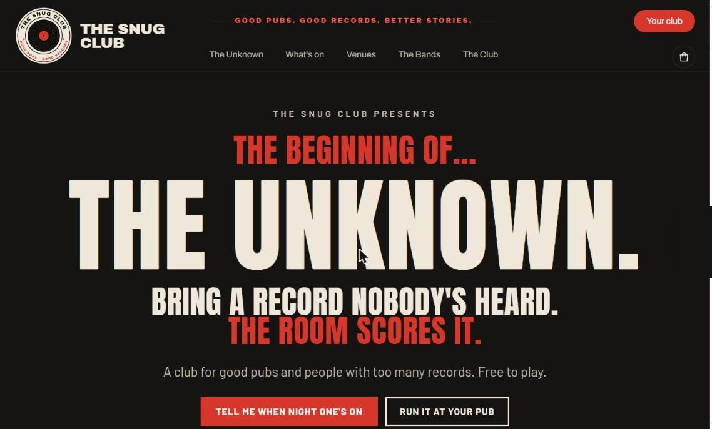
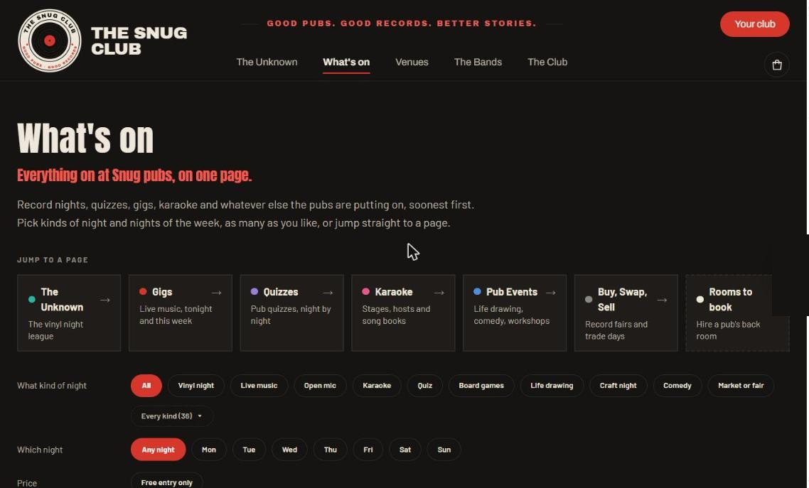
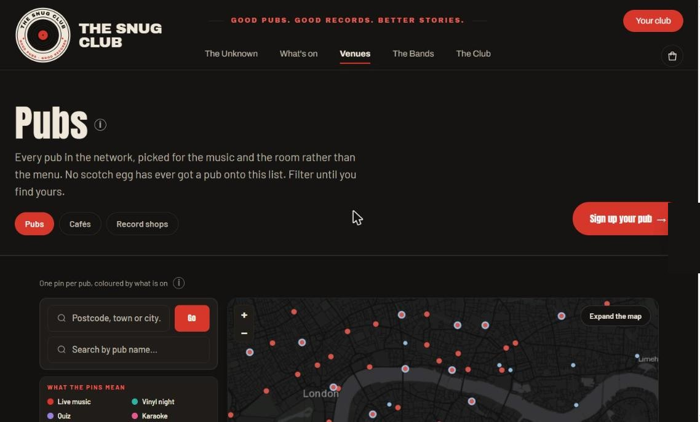
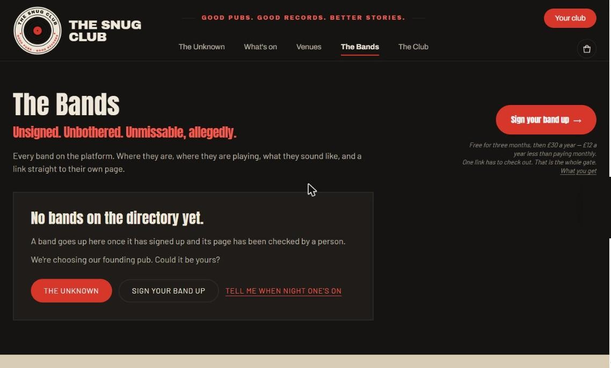

# The Snug Club: a case study

**James Simpson, founder and product lead.**

The Snug Club is a two-sided marketplace for pubs, bands and the people who go to see them: gigs, vinyl nights, quizzes, karaoke, record fairs, a paid members' club and a shop. It is in pre-launch, piloting in London. I designed and built it alone, alongside a full-time product role, in roughly five weeks.

[Visit the live site](https://www.thesnug-club.co.uk)

The screenshots below are from the current build.

## The problem

Grassroots music venues are closing, and the pubs that still put music on have no good way to fill a quiet Tuesday. Bands cannot easily find pubs that want them, and fans find out about a night after it has happened. Each side has a tool for its own half of the problem and nothing joins them up.

## What I built

**For fans.** What is on near you, by kind of night, on a map. A free account to browse and a paid membership to take part, with a joining pint at a local pub that the club pays for.

Every pub sits on a map, one pin per pub, coloured by what is on that week.

**For pubs and bands.** Their own admin, with listings, bookings, a directory each side can search, and dashboards of views, clicks and saves by where the visitor came from. Every pub and band is checked by a person before it goes public.

**For the business.** Stripe subscriptions for members, guest checkout for the shop, payouts to pubs, promo codes, and a head office for verification, moderation and support.

**Phone apps** for members and for pub and band admins, built in Expo, sharing one API with the website.

## Built in five weeks

From nothing to a working two-sided marketplace, alongside a full-time job: the concept and the brand, the data model, the pricing, the release process, the website and two phone apps, and the compliance a regulated marketplace needs before it can open. Every change goes to a staging environment first and is checked there before it reaches the live site.

## Decisions worth explaining

**One home for every number.** A price, a free period or a promise lives in exactly one module, and every page, email, the terms and the apps read it from there. The same number typed in two places had drifted five times early on. Now when a price changes, the site, the checkout and the contract change together.

**Guards seen failing first.** The site has 128 automated guard suites, covering prices, offers, payments, permissions and the legal pages. A new check has to be run against the broken version and seen to fail before it counts, because a check that has never failed proves nothing.

**Honesty over scarcity.** An early version showed limited-availability counters that were placeholders rather than real counts. A false scarcity claim is a banned practice under the Digital Markets, Competition and Consumers Act 2024, so the counters came off and the offers now state the cap without pretending to count down.

**AI where it saves real time, with guardrails.** A "Write it for me" feature drafts a venue's page from the facts the landlord types in: prompt design, input guardrails, a daily rate limit, usage logging and 45 automated checks, with the model swappable in one line. A help assistant answers only from the site's own help pages, cites them, and opens the right page rather than sending a screenshot.

**Compliance as product work.** Ofcom's checker confirmed the site is a regulated user-to-user service under the Online Safety Act, so the illegal-content risk assessment, the children's access assessment and a public moderation policy were done before the forum could open. ICO registration, music licensing guidance and consumer pricing rules were handled the same way, as features the site enforces rather than documents in a drawer.

## Stack

Next.js and TypeScript, Postgres on Neon, Stripe, Vercel, Resend for email, OpenAI, and Expo for the apps.

## What I learnt

The hardest part of a marketplace is not the software but the order you build it in: which side to win first, and what each side needs to see before it trusts the other. Building it alone made every trade-off visible, from what a pub will actually type into a form on a busy Friday to what the terms have to say before a single member pays.

---

The code is private because it is a live company, but I am happy to walk through it in an interview.

A print version of this case study is in this repository: [The-Snug-Club-case-study.pdf](The-Snug-Club-case-study.pdf).
